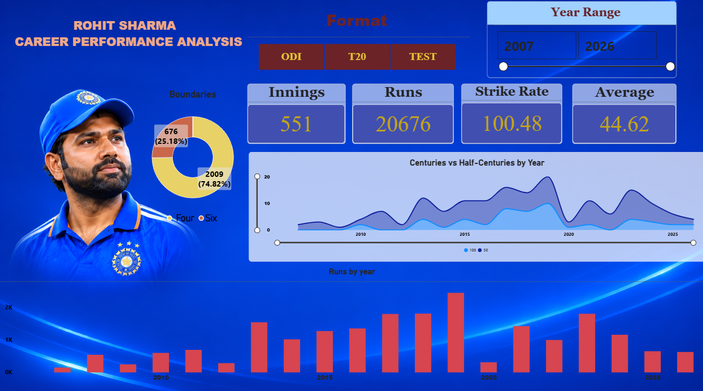

# Rohit Sharma Career Performance Analysis Dashboard

## Project Overview
An interactive Power BI dashboard developed to analyse Rohit Sharma's cricket career statistics across ODI, T20 and Test formats.

## Tools & Technologies
- Power BI
- Microsoft Excel
- Power Query
- DAX

## Key Features
- Interactive cricket format filters (ODI, T20, Test).
- Year-wise performance analysis (2007–2026).
- KPI cards for runs, innings, batting average and strike rate.
- Centuries and half-centuries analysis.
- Boundary analysis (Fours and Sixes).
- Interactive data visualisations.

## Dashboard Preview

## Files Included
- ROHIT.pbix – Power BI dashboard.
- Rohit Sharma Statistics.xlsx – Dataset.
- DashBoard.png – Dashboard screenshot.

## Objective
To demonstrate practical data analytics skills through data analysis, DAX calculations, interactive visualisation and dashboard development.

## Author
Lavesh Suwasiya

GitHub: Lavesh9
